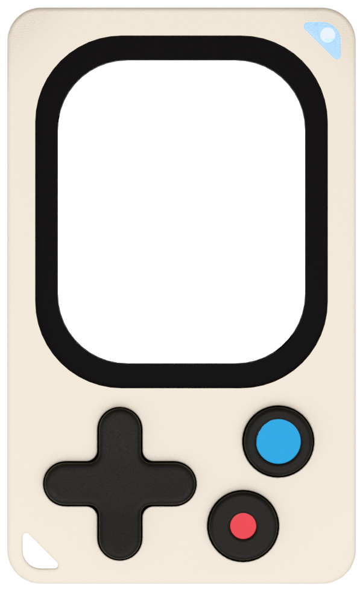

<div align="center" markdown="1">



# kode-sdk

**The SDK for the Kode Dot: write an app in C, and run it on the board**

[](https://github.com/espressif/esp-idf)


[Documentation](https://docs.kode.diy/sdk/overview) ·
[Quick start](#quick-start) ·
[Examples](#examples) ·
[kodeOS](https://github.com/kodediy/KodeOS) ·
[App template](https://github.com/kodediy/kode-app-template)

</div>

---

The kode SDK is how you write firmware for the **Kode Dot**, a handheld board built around an ESP32-P4: AMOLED touch screen, six buttons, RGB LED, battery, microSD, sound, motion sensors, NFC, RFID, infrared, and Wi-Fi and Bluetooth through an ESP32-C5. kodeOS, the board's operating system, is built with it, and so is every app.

- **One owner per device.** Each part of the board belongs to one Active Object ([QP/C](https://www.state-machine.com/products/qp)); your code asks it with an event and never touches the chip.
- **Two layers.** `kode.h` has calls that wait, for `app_main()` and your tasks; `kode_sys.h` has calls that never wait, for an Active Object of your own.
- **Apps are whole firmwares.** kodeOS installs them in place and gets the board back on any reset.

```c
#include "kode.h"

void app_main(void)
{
    kode_init();                    /* start the board */
    kode_led_set_rgb(0, 255, 0);    /* green */
    kode_delay(1000);
    kode_exit();                    /* back to kodeOS */
}
```

## Quick start

You need a Kode Dot running kodeOS and [ESP-IDF v6.1](https://docs.espressif.com/projects/esp-idf/en/v6.1/esp32p4/get-started/).

```bash
. <path-to-esp-idf>/export.sh
idf.py -C examples/buttons_led build
idf.py -C examples/buttons_led -p PORT flash
```

`flash` writes the app to the board's mailbox; kodeOS installs it and starts it. The LED turns green and the top button toggles it. Hold the bottom and left buttons for a second to go back to kodeOS.

To start an app of your own, use the [app template](https://github.com/kodediy/kode-app-template) or copy the example closest to it.

## Examples

| | |
|---|---|
| `buttons_led` | buttons in, LED colour out |
| `console_actions` | console commands of your own |
| `storage` | NVS and a file on the internal storage |
| `audio` | a tone and a WAV recording |
| `imu` | accelerometer, gyroscope and magnetometer |
| `haptic` | vibration |
| `nfc_read` / `rfid_read` | read an NFC tag or a 125 kHz tag |
| `ir_remote` | learn and send an infrared code |
| `expansion_io` / `exp_bus` | GPIO, PWM, ADC and I2C on the expansion header |
| `power` | battery reading and power off |
| `network` / `mqtt` | ping, HTTP and MQTT over Wi-Fi |
| `ble_peripheral` | a Bluetooth service of your own |
| `display_lvgl` | LVGL on the screen |
| `arduino_hello` | the same idea as an Arduino sketch |

## Use it in your project

```yaml
# main/idf_component.yml
dependencies:
  kodediy/kode:
    git: https://github.com/kodediy/kode-sdk.git
    path: components/kode
    version: v0.1.0
```

Your project also sets `set(IDF_TARGET esp32p4)` in `CMakeLists.txt` and the board's partition table in `sdkconfig.defaults`. Copy both from an example: [Use the SDK](https://docs.kode.diy/sdk/overview) explains why.

## Documentation

Everything else is at **[docs.kode.diy](https://docs.kode.diy)**: [the SDK](https://docs.kode.diy/sdk/overview), [the facade `kode.h`](https://docs.kode.diy/sdk/kode), [the Active Objects](https://docs.kode.diy/sdk/kaos/overview), [the drivers](https://docs.kode.diy/sdk/kdrv/overview), [the design rules](https://docs.kode.diy/sdk/design-rules) and [the console protocol](https://docs.kode.diy/internals/console-protocol). Each component also has a short README that links its page.

## Contributing

Bugs, ideas and pull requests are welcome. Read [CONTRIBUTING.md](https://github.com/kodediy/.github/blob/main/CONTRIBUTING.md) first; the checks a change must pass are `tools/host_tests.sh`, `tools/check_layers.sh` and `idf.py -C tests/target build`, run on your machine.

## Licence

[GPL-3.0-or-later](LICENSE). QP/C (Quantum Leaps) and RFAL (STMicroelectronics) keep their own licences; [NOTICE.md](NOTICE.md) says which applies where.
